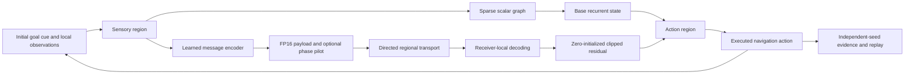

# NeuroWave-X implementation

The standalone `aether` package has no imports from other Supermix projects or the existing Poseidon `aether.py`. All implementation here is newly written; the repositories and 2026 papers listed in the user proposal are research leads, not verified dependencies or established results in this release.

`ModelConfig` bounds the dimensions. `Topology` owns directed scalar/message links and neuron membership. Runtime tensors are compiled from this graph; checkpoint loading must reconcile topology and all derived buffers. Structural mutation is deliberately unsupported.

Each scalar edge carries a trainable real weight shared across the neuron's 32 components. Incoming weighted states are degree-normalized, transformed by a learned shared matrix and combined with self-recurrence and sensory drive. The base activation is tanh. Auxiliary dynamics add `gain * clip(decoded_message, -1, 1)` after the base activation. Gain starts at precisely zero; scalar parameters and topology are paired by seed across arms.

Observations enter region zero. The action head reads the final region. Inter-region information must propagate through scalar graph edges or counted wave packets; global cue broadcasting is excluded. Regional pooling is a local aggregation. Receiver queries and receiver oscillator phases use only the receiving region's local state.

All auxiliary protocols use encoders/decoders with identical tensor dimensions. Scalar-matched repeats a learned one-dimensional encoder bottleneck through the fixed packet shape. Vector uses the full values. Attention learns receiver-local queries and sender keys derived from received packet contents. Phase uses a learned phase rotation and coherence gate; its first mode is an explicit phase pilot recovered from FP16 wire values. With four modes, the pilot occupies 25% of payload slots. Modes uses normalized-Laplacian carriers; wave combines modes and phases. Phase-bearing pilots occupy the first mode instead of its encoded content, and bypass sender-side spatial attenuation so the transmitted phase remains identifiable.

The carrier graph is symmetrized only to calculate an orthonormal basis; packet links retain their original direction. Deterministic sign/subspace conventions align truly degenerate eigenvectors without mixing distinct eigenvalues. A topology version cannot be swapped into a live packet bus.

`PacketBus` is the validating NumPy reference with immutable real-pair packets. The tensor route performs the same clean FP16 payload rounding, directed aggregation and receiver calculation, using a straight-through gradient estimator during learning. A conformance check decodes delivered packets independently in NumPy before every arm is trained. Learned-state fingerprints remain stable through this check and through query rollouts.

Reference-channel disturbances have independent RNG streams. Cross-talk mixes packets within one same-source submission; it is not a global electromagnetic interference simulation. Congestion is seeded erasure plus a strict per-tick admission budget, not a router network queue model. Admission counts attempted bytes, including packets subsequently erased. Delayed packets retain their emission tick.

The source snapshot, recorded config, checkpoint and environment versions form the replay inputs. Every checkpoint stores ordinary, longer-delay and intervention query outcomes; replay executes all of them. Hash receipts cover finalized output files. The first milestone supplies neither an external dataset nor a source-pinned Sonapse adapter.

Implementation references: [PyTorch deterministic operations](https://docs.pytorch.org/docs/stable/generated/torch.use_deterministic_algorithms.html), [PyTorch reproducibility](https://docs.pytorch.org/docs/stable/notes/randomness.html), and [symmetric eigenproblems](https://docs.scipy.org/doc/scipy/reference/generated/scipy.linalg.eigh.html). The tested environment is recorded in each run rather than inferred from online version labels.
